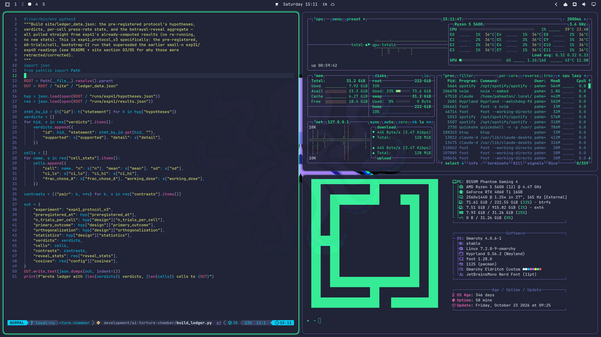

<p align="center">

</p>
<p>
Eldritch is a community-driven dark theme inspired by Lovecraftian horror. With tones from the dark abyss and an emphasis on green and blue, it caters to those who appreciate the darker side of life.
</p>

A personal spin on the [Omarchy Eldritch theme](https://github.com/OldJobobo/omarchy-eldritch-theme),
ported to Omarchy 4 (Quattro). Main Eldritch repo can be found [here](https://github.com/eldritch-theme/eldritch).

### Showcase:


### What's different from upstream
- **Omarchy 4 format**: a `colors.toml` palette instead of the per-app Waybar, Mako, Walker, SwayOSD and Wofi styles.
- **Animations**: Material-style popin for windows and layers, sliding workspaces, vertical slide for the special workspace, and a close animation that fades out before neighbours slide in.
- **Windows**: 10px squircle corners, a solid green active border, a muted comment-blue inactive border, and a faint green glow around the focused window.
- **Terminals**: Alacritty, Kitty, Ghostty and Foot share one palette with a green cursor.
- **Shell**: lock screen in the style of the old hyprlock (green text, cyan border), and green-tinted selection in the launcher, menus and panel controls.
- **Boot and login screen**: the Eldritch octopus as the Plymouth/SDDM logo (Omarchy menu → Style → Unlock).
- **btop**: a green → orange → red palette across all graphs and meters.
- **Neovim** and **VS Code** use the official Eldritch themes.

### Installation (Omarchy 4 / Quattro):
Omarchy ignores `*.lua`, terminal configs and `vscode.json` from themes cloned
straight into `~/.config/omarchy/themes` (it detects the `.git` directory), which
would drop the animations, terminal, Neovim and VS Code themes. Clone the repo
elsewhere and symlink it instead:

```
git clone https://github.com/Pahmaton/omarchy-eldritch-custom.git ~/Projects/omarchy-eldritch-custom
ln -s ~/Projects/omarchy-eldritch-custom ~/.config/omarchy/themes/omarchy-eldritch-custom
omarchy theme set omarchy-eldritch-custom
```

#### Remove Opacity
Add this to the end of `~/.config/hypr/hyprland.lua`:
```lua
-- Force full opacity (overrides default Omarchy opacity rules)
o.window({ tag = "default-opacity" }, { opacity = "1 1" })
```
